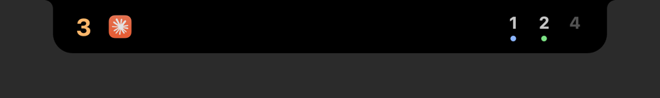
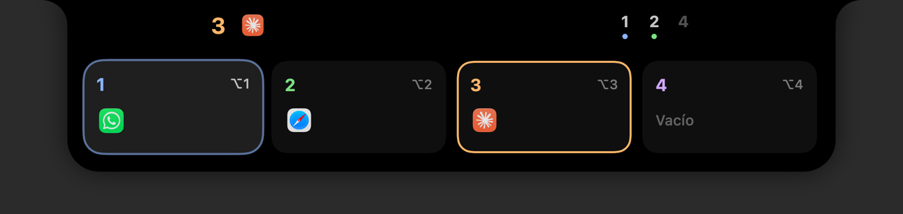
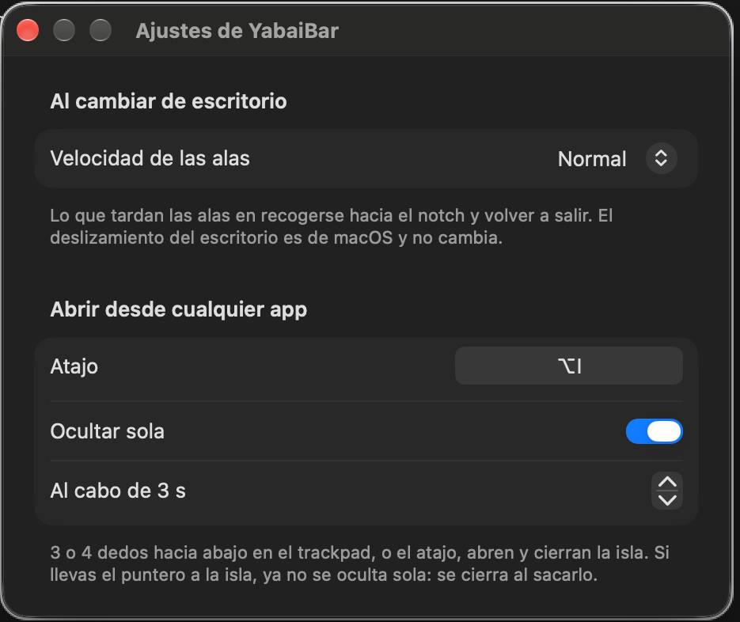

# YabaiBar

> **English summary.** YabaiBar turns the MacBook notch into a Dynamic Island for your [yabai](https://github.com/asmvik/yabai) spaces: see your desktops and their apps, jump to one with a click, control what's playing and run a Pomodoro. It works on any MacBook with a notch (MacBook Pro from 2021, MacBook Air from 2022) and needs yabai installed. Install it with `brew install --cask jerickgm89/tap/yabaibar`. It isn't notarized: the first time, go to System Settings › Privacy & Security › Open Anyway. The rest of this README is in Spanish.

Una isla alrededor del notch del Mac que muestra tus escritorios de [yabai](https://github.com/asmvik/yabai) con los íconos de sus apps. Ábrela para saltar a cualquier escritorio, controlar la música o empezar un Pomodoro. Su diseño se inspira en [Atoll](https://github.com/Ebullioscopic/Atoll) (ver [Agradecimientos](#agradecimientos)).

<p align="center">
  
</p>

<p align="center">
  
</p>

## Qué hace

- **Tus escritorios, siempre a la vista:** el activo a la izquierda del notch, con sus apps, y los demás a la derecha.
- **Un clic para cambiar de escritorio:** abre la isla y pulsa la tarjeta del escritorio al que quieres ir. macOS usa su propia animación.
- **Atajos automáticos:** cuando creas un escritorio, YabaiBar te ofrece añadirle su atajo para que el clic funcione.
- **Música:** lo que suena, con sus botones, en TIDAL o en cualquier app del «Ahora suena» de macOS.
- **Pomodoro:** foco y descansos, con un anillo de progreso y sonidos suaves al terminar cada fase.
- **Avisos:** el cargador y la batería baja, y un botón para que el Mac no se duerma.
- **Se aparta cuando estorba:** se oculta en Mission Control y se recoge en las apps a pantalla completa.

## Requisitos

- **Un MacBook con notch:** un MacBook Pro desde 2021 o un MacBook Air desde 2022, con macOS 14 o posterior.
- **[yabai](https://github.com/asmvik/yabai) instalado y en marcha.** Configúralo leyendo antes [su wiki](https://github.com/asmvik/yabai/wiki):

  ```bash
  brew install asmvik/formulae/yabai
  yabai --start-service
  ```

  No hace falta la scripting addition ni desactivar SIP.

## Instalación

```bash
brew install --cask jerickgm89/tap/yabaibar
```

También puedes descargar el DMG de [Releases](https://github.com/jerickgm89/yabaiDynamicIsland/releases) y arrastrar YabaiBar a Aplicaciones.

**La primera vez, macOS la bloquea,** porque no está notarizada por Apple:

1. Ábrela y cierra el aviso.
2. Ve a Ajustes del Sistema › Privacidad y seguridad y pulsa «Abrir igualmente».

Solo hay que hacerlo una vez. Al abrirse, la ventana **«Primeros pasos»** revisa lo que falta (yabai, los atajos, los permisos) y te dice cómo arreglarlo. Puedes volver a abrirla desde la isla: clic › «Primeros pasos…».

Para actualizarla: `brew upgrade --cask yabaibar`.

## Cómo se usa

| Para | Haz esto |
| --- | --- |
| Abrir la isla | Pasa el puntero por el notch, desliza 3 o 4 dedos hacia abajo en el trackpad o pulsa ⌥I |
| Ir a un escritorio | Clic en su tarjeta |
| Cambiar de canción | Los botones de la franja de música, o dos dedos de lado sobre ella |
| Empezar o pausar un Pomodoro | El reloj de la esquina izquierda, o ⌥P desde cualquier app |
| Mantener el Mac despierto | El sol de la esquina derecha |
| Ver el menú y los ajustes | Clic en la isla, fuera de las tarjetas |

**Para que el clic cambie de escritorio** hacen falta dos cosas, y «Primeros pasos» las revisa:

- **Los atajos «Ir al escritorio N»** de Ajustes › Teclado › Atajos de teclado › Mission Control. YabaiBar te ofrece añadir los que falten, con el mismo modificador que los tuyos (⌥5 si los demás son ⌥1 a ⌥4). Con «Añadir siempre», los escritorios nuevos lo reciben solos. Mission Control solo tiene atajos del 1 al 9.
- **El permiso de Accesibilidad.** macOS lo pide la primera vez que pulsas una tarjeta.

**Para el gesto de 3 o 4 dedos,** App Exposé tiene que estar desactivado en Ajustes › Trackpad › Más gestos, porque usa el mismo movimiento.

## Ajustes

Clic en la isla › «Ajustes…». Los cambios se aplican al momento.

<p align="center">
  
</p>

- **General:**
  - la velocidad de la animación al cambiar de escritorio;
  - cómo se abre la isla (con el puntero o con el atajo) y si se oculta sola;
  - las señales de yabai y los atajos de los escritorios nuevos;
  - los avisos de batería y el botón de mantener despierto.
- **Música:** si se muestra, de qué app, las barras de la isla cerrada y el aviso al cambiar de canción.
- **Pomodoro:**
  - los tiempos (Clásico 25/5/15, Largo, Corto o los tuyos), si las fases empiezan solas y el objetivo del día;
  - los sonidos y si se baja la música en el aviso;
  - su atajo.

## Compatibilidad

| | Estado |
| --- | --- |
| MacBook Pro desde 2021 y MacBook Air desde 2022 (con notch) | Soportado. Probado en el MacBook Pro de 16" con M1 Pro |
| MacBook Pro OLED con Dynamic Island (finales de 2026) | Aún no |
| Monitores externos, Macs sin notch y la tapa cerrada | Aún no: llegan en una próxima versión |
| Macs con Intel | No |

La isla mide el notch de tu pantalla, así que se ajusta a cada modelo y a cualquier escala de pantalla.

**Si algo no va bien:**

- **La isla dice «YB ⚠︎»:** yabai no responde. Arráncalo con `yabai --start-service`.
- **El clic no cambia de escritorio:** abre «Primeros pasos». Si el permiso de Accesibilidad ya está marcado, quita YabaiBar de la lista con «−» y vuelve a pulsar una tarjeta.
- **Algo se ve descolocado en tu Mac:** abre un [issue](https://github.com/jerickgm89/yabaiDynamicIsland/issues) y pega lo que copia «Primeros pasos» › «Copiar datos».

> El gesto del trackpad y la música usan partes de macOS que no son públicas, así que una actualización de macOS podría romperlos. El atajo ⌥I siempre funciona. Mientras YabaiBar está abierta, ⌥I y ⌥P son suyos: ya no escriben «ˆ» ni «π».

## Para desarrolladores

<details>
<summary>Compilar desde el código</summary>

Hace falta Xcode con Swift 6 y [XcodeGen](https://github.com/yonaskolb/XcodeGen) (`brew install xcodegen`):

```bash
git clone https://github.com/jerickgm89/yabaiDynamicIsland.git
cd yabaiDynamicIsland
xcodegen generate
xcodebuild -project YabaiBar.xcodeproj -scheme YabaiBar -configuration Release -derivedDataPath build build
ditto build/Build/Products/Release/YabaiBar.app /Applications/YabaiBar.app
```

- **Tests:** `xcodebuild -project YabaiBar.xcodeproj -scheme YabaiBar -destination 'platform=macOS' -derivedDataPath build test`.
- **Firma:** el permiso de Accesibilidad depende de ella. Para no perderlo en cada compilación, crea en Acceso a Llaveros un certificado autofirmado de firma de código y añade `CODE_SIGN_IDENTITY="<su nombre>"` al comando.
- **Publicar:** `scripts/release.sh <versión> [--dry-run]` hace el DMG, el release de GitHub y el cask del tap, con las notas de `CHANGELOG.md`.

</details>

<details>
<summary>Señales de yabai</summary>

YabaiBar le pide a yabai que la avise al crear, cerrar o minimizar ventanas y al cambiar los espacios o las pantallas (`yabai -m signal --add`, con etiquetas `yb_*`), sin tocar tu `yabairc`. Si yabai se reinicia, las vuelve a añadir.

Si prefieres tenerlas en tu `yabairc`, apaga «Señales automáticas» en Ajustes, añade esto y reinicia yabai:

```sh
YB_ACTION='notifyutil -p com.jerickdev.yabaibar.refresh'
for event in window_created window_destroyed window_minimized window_deminimized \
             space_created space_destroyed display_added display_removed display_changed; do
  yabai -m signal --add event=$event label=yb_$event action="$YB_ACTION"
done
```

Si mueves ventanas entre espacios con skhd, añade `; notifyutil -p com.jerickdev.yabaibar.refresh` al final de esos atajos para que la isla se entere al momento.

</details>

## Agradecimientos

**[Atoll](https://github.com/Ebullioscopic/Atoll)**, de Hariharan Mudaliar ([@Ebullioscopic](https://github.com/Ebullioscopic)) y su comunidad. YabaiBar se inspira en su diseño: cómo se coloca la isla sobre el notch, su forma, cómo crece al pasar el puntero, la vibración del trackpad y las animaciones al abrirse y cerrarse. ¡Gracias! Y gracias también a [boring.notch](https://github.com/TheBoredTeam/boring.notch), de TheBoredTeam, del que nació Atoll.

**[mediaremote-adapter](https://github.com/ungive/mediaremote-adapter)**, de Jonas van den Berg y sus colaboradores, que permite leer y controlar «Ahora suena». Va incluido en `Vendor/` con su licencia BSD-3-Clause.

**[yabai](https://github.com/asmvik/yabai)**, que hace posible todo lo demás.

## Licencia

[MIT](LICENSE). El código de `Vendor/mediaremote-adapter/` conserva su propia licencia, [BSD-3-Clause](Vendor/mediaremote-adapter/LICENSE).
