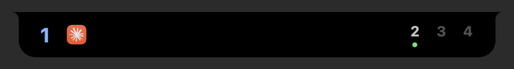
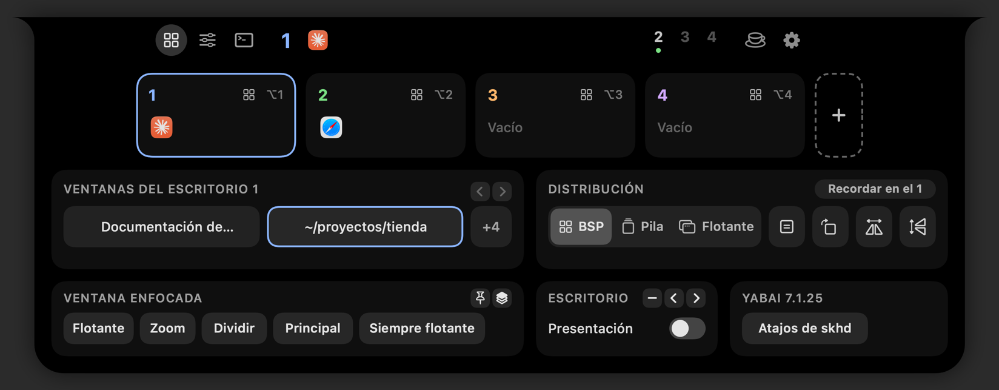
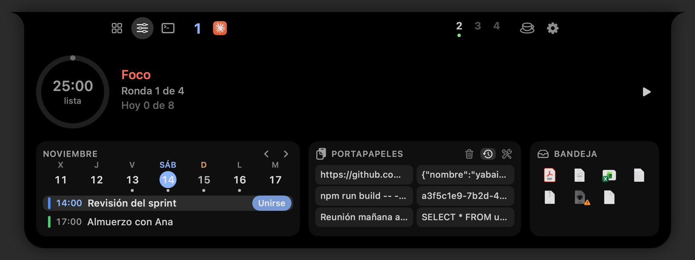
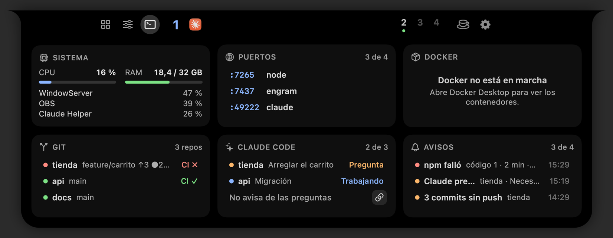
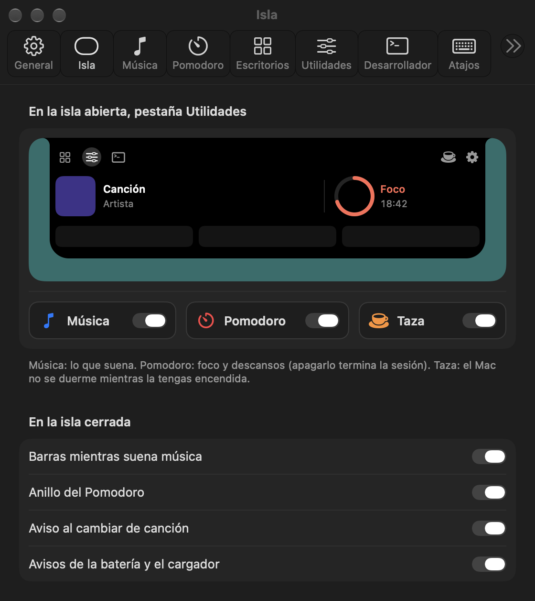

# YabaiBar

> **English summary.** YabaiBar turns the MacBook notch into a Dynamic Island for your [yabai](https://github.com/asmvik/yabai) spaces: see your desktops and their apps, jump to one with a click, and control yabai from the island. Open it and you get three tabs: Desktops, Utilities (music, Pomodoro, calendar, clipboard tools, a file tray) and Developer (system monitor, ports, Docker, Claude Code, Git and GitHub, terminal notices). It works on any MacBook with a notch (MacBook Pro from 2021, MacBook Air from 2022) and needs yabai installed. Install it with `brew install --cask jerickgm89/tap/yabaibar`. It isn't notarized: the first time, go to System Settings › Privacy & Security › Open Anyway. The rest of this README is in Spanish.

Una isla alrededor del notch del Mac que muestra tus escritorios de [yabai](https://github.com/asmvik/yabai) con los íconos de sus apps. Ábrela para saltar a cualquier escritorio, controlar yabai, la música o un Pomodoro, y para tener a mano tu calendario, el portapapeles, una bandeja de archivos y el estado de tus herramientas de desarrollo. Su diseño se inspira en [Atoll](https://github.com/Ebullioscopic/Atoll) (ver [Agradecimientos](#agradecimientos)).

<p align="center">
  
</p>

<p align="center">
  
  <br><sub><b>Escritorios:</b> tus tarjetas y el panel de yabai</sub>
</p>

<p align="center">
  
  <br><sub><b>Utilidades:</b> música y Pomodoro, calendario, portapapeles y bandeja</sub>
</p>

<p align="center">
  
  <br><sub><b>Desarrollador:</b> sistema, puertos, Docker, Git, Claude Code y avisos</sub>
</p>

## Qué hace

Con la isla cerrada, siempre a la vista: el escritorio activo a la izquierda del notch, con sus apps, y los demás a la derecha. Al abrirla tiene **tres pestañas**:

- **Escritorios:** una tarjeta por escritorio. Un clic en una tarjeta cambia de escritorio (macOS usa su propia animación). Debajo, un **panel de yabai** con las ventanas del escritorio activo y los botones para ordenarlas: distribución (mosaico, pila o flotante), equilibrar, girar, voltear, modo presentación, hacer principal una ventana, «esta app, siempre flotante»… Arrastra una ventana a otra tarjeta para moverla.
- **Utilidades:**
  - **Música:** lo que suena, con sus botones, en TIDAL o en cualquier app del «Ahora suena» de macOS.
  - **Pomodoro:** foco y descansos, con un anillo de progreso y sonidos suaves al terminar cada fase.
  - **Calendario:** tus próximos eventos, con «Unirse» a las videollamadas.
  - **Portapapeles:** herramientas (JSON, base64, JWT, SHA-256…), un cuentagotas de color y, si lo activas, el historial.
  - **Bandeja:** suelta archivos sobre la isla y llévalos a otra app.
- **Desarrollador:**
  - **Sistema:** CPU, memoria y los procesos que más gastan.
  - **Puertos y Docker:** los servidores locales y los contenedores, para abrirlos, copiar su URL, cerrarlos o pararlos.
  - **Claude Code:** tus sesiones abiertas, y un aviso cuando una te hace una pregunta.
  - **Git y GitHub:** el estado de tus repositorios y el CI de tu último push.
  - **Avisos:** los de la terminal (un comando largo que termina), Claude Code y Git, y los 10 últimos guardados.

Y, en general:

- **Atajos automáticos:** cuando creas un escritorio, YabaiBar te ofrece añadirle su atajo para que el clic funcione.
- **Avisos en la isla cerrada:** el cargador y la batería baja, una canción nueva, el Pomodoro, el calendario y lo que pase en la pestaña Desarrollador. Un punto en la píldora de una pestaña avisa de una novedad.
- **Mantener el Mac despierto,** con un botón (una taza).
- **Se aparta cuando estorba:** se oculta en Mission Control y se recoge en las apps a pantalla completa.
- **Ligera con la isla cerrada:** el monitor del sistema, los puertos, Docker y el panel de yabai solo se miran con su pestaña a la vista. Lo demás se entera por eventos.

## Requisitos

- **Un MacBook con notch:** un MacBook Pro desde 2021 o un MacBook Air desde 2022, con macOS 14 o posterior.
- **[yabai](https://github.com/asmvik/yabai) instalado y en marcha.** Configúralo leyendo antes [su wiki](https://github.com/asmvik/yabai/wiki):

  ```bash
  brew install asmvik/formulae/yabai
  yabai --start-service
  ```

  No hace falta la scripting addition ni desactivar SIP: solo unas pocas acciones opcionales del panel de yabai (fijar una ventana, crear, quitar y mover escritorios, cambiar de escritorio al instante) la usan, y sin ella se ven atenuadas. Ojo: la scripting addition de yabai no soporta todas las versiones de macOS (ver «Escritorios: el panel de yabai» más abajo).

## Instalación

```bash
brew install --cask jerickgm89/tap/yabaibar
```

También puedes descargar el DMG de [Releases](https://github.com/jerickgm89/yabaiDynamicIsland/releases) y arrastrar YabaiBar a Aplicaciones.

**La primera vez, macOS la bloquea,** porque no está notarizada por Apple:

1. Ábrela y cierra el aviso.
2. Ve a Ajustes del Sistema › Privacidad y seguridad y pulsa «Abrir igualmente».

Solo hay que hacerlo una vez. Al abrirse, la ventana **«Primeros pasos»** revisa lo que falta (yabai, los atajos, los permisos) y te dice cómo arreglarlo. Puedes volver a abrirla desde la isla: clic › «Primeros pasos…».

Para actualizarla: `brew upgrade --cask yabaibar`.

## Cómo se usa

| Para | Haz esto |
| --- | --- |
| Abrir la isla | Pasa el puntero por el notch, desliza 3 o 4 dedos hacia abajo en el trackpad o pulsa ⌥I |
| Cambiar de pestaña | Las tres píldoras de la esquina izquierda, o ⌥← y ⌥→. Si abriste la isla con ⌥I o el gesto, también h (anterior) y l (siguiente), como en vim |
| Ir a un escritorio | Clic en su tarjeta |
| Mover una ventana a otro escritorio | En la pestaña Escritorios, arrastra su botón del panel a la tarjeta del escritorio |
| Cambiar de canción | Los botones de la franja de música (en Utilidades), o dos dedos de lado sobre ella |
| Empezar o pausar un Pomodoro | Su botón en Utilidades, o ⌥P desde cualquier app |
| Guardar un archivo en la bandeja | Arrástralo sobre la isla, cerrada o abierta. Para sacarlo, arrástralo desde la bandeja a otra app |
| Mantener el Mac despierto | La taza, a la derecha de la isla abierta, junto al engranaje |
| Abrir los ajustes | El engranaje de la esquina derecha |
| Cerrar la isla | Esc (si la abriste con ⌥I o el gesto), o un clic en otra app |
| Ver el menú | Clic derecho en la isla, o un clic fuera de las tarjetas |

**Para que el clic cambie de escritorio** hacen falta dos cosas, y «Primeros pasos» las revisa:

- **Los atajos «Ir al escritorio N»** de Ajustes › Teclado › Atajos de teclado › Mission Control. YabaiBar te ofrece añadir los que falten, con el mismo modificador que los tuyos (⌥5 si los demás son ⌥1 a ⌥4). Con «Añadir siempre», los escritorios nuevos lo reciben solos. Mission Control solo tiene atajos del 1 al 9.
- **El permiso de Accesibilidad.** macOS lo pide la primera vez que pulsas una tarjeta.

**Para el gesto de 3 o 4 dedos,** App Exposé tiene que estar desactivado en Ajustes › Trackpad › Más gestos, porque usa el mismo movimiento.

**Permisos:** YabaiBar solo pide lo que necesita, y casi todo cuando tú lo activas.

- **Accesibilidad,** para pulsar el atajo del escritorio al que vas.
- **Calendarios,** solo si pulsas «Dar acceso» en el módulo del calendario. Solo lee.
- **Pegar desde otras apps,** solo si activas el historial del portapapeles.
- **Claude Code,** solo si pulsas «Conectar con Claude Code…» en Ajustes. Pide confirmación y guarda una copia de tu `settings.json`.

## Ajustes

El engranaje de la isla abierta abre los ajustes. Los cambios se aplican al momento.

<p align="center">
  
</p>

- **General:** iniciar al arrancar, cómo se abre la isla y si se oculta sola, la velocidad de las alas y «Primeros pasos».
- **Isla:** una isla en miniatura que cambia al encender o apagar la música, el Pomodoro y la taza, y lo que se ve en la isla cerrada (barras, anillo y avisos).
- **Música:** de qué app.
- **Pomodoro:** los tiempos (Clásico 25/5/15, Largo, Corto o los tuyos), si las fases empiezan solas, el objetivo del día, los sonidos y si se baja la música en el aviso.
- **Escritorios:** el panel de yabai (y si se cambia de escritorio al instante), el estado de yabai y «Reiniciar yabai…», lo que la app recuerda de cada escritorio, las señales de yabai, los atajos de los escritorios nuevos y la chuleta de tus atajos de skhd.
- **Utilidades:** el calendario (el permiso, los avisos y qué calendarios se ven) y el portapapeles (el historial y las apps que se ignoran).
- **Desarrollador:** qué módulos se ven (Docker, Git y GitHub con `gh`), las carpetas de Git que se vigilan y sus avisos, conectar Claude Code y los avisos de la terminal.
- **Atajos:** el de la isla (⌥I), el del Pomodoro (⌥P) y el gesto del trackpad.
- **Acerca de:** la versión, tu Mac y su notch, y «Copiar datos» para los issues.

## Compatibilidad

| | Estado |
| --- | --- |
| MacBook Pro desde 2021 y MacBook Air desde 2022 (con notch) | Soportado. Probado en el MacBook Pro de 16" con M1 Pro |
| MacBook Pro OLED con Dynamic Island (finales de 2026) | Aún no |
| Monitores externos, Macs sin notch y la tapa cerrada | Aún no: llegan en una próxima versión |
| Macs con Intel | No |

La isla mide el notch de tu pantalla, así que se ajusta a cada modelo y a cualquier escala de pantalla.

**Si algo no va bien:**

- **La isla dice «YB ⚠︎»:** yabai no responde. Arráncalo con `yabai --start-service`. Si está en marcha pero `yabai -m query --spaces` devuelve algo cortado (solo `[`), reinícialo con `yabai --restart-service` (o «Reiniciar yabai…» en el menú de la isla).
- **Crear, quitar o mover un escritorio no hace nada:** la scripting addition de yabai no soporta tu versión de macOS. YabaiBar lo avisa con «Sin soporte en macOS …» y atenúa esos botones. Mission Control sigue sirviendo para eso.
- **El clic no cambia de escritorio:** abre «Primeros pasos». Si el permiso de Accesibilidad ya está marcado, quita YabaiBar de la lista con «−» y vuelve a pulsar una tarjeta.
- **Algo se ve descolocado en tu Mac:** abre un [issue](https://github.com/jerickgm89/yabaiDynamicIsland/issues) y pega lo que copia «Primeros pasos» › «Copiar datos».

> El gesto del trackpad y la música usan partes de macOS que no son públicas, así que una actualización de macOS podría romperlos. El atajo ⌥I siempre funciona. Mientras YabaiBar está abierta, ⌥I y ⌥P son suyos: ya no escriben «ˆ» ni «π».

## Para desarrolladores

<details>
<summary>Compilar desde el código</summary>

Hace falta Xcode con Swift 6 y [XcodeGen](https://github.com/yonaskolb/XcodeGen) (`brew install xcodegen`):

```bash
git clone https://github.com/jerickgm89/yabaiDynamicIsland.git
cd yabaiDynamicIsland
xcodegen generate
xcodebuild -project YabaiBar.xcodeproj -scheme YabaiBar -configuration Release -derivedDataPath build build
ditto build/Build/Products/Release/YabaiBar.app /Applications/YabaiBar.app
```

- **Tests:** `xcodebuild -project YabaiBar.xcodeproj -scheme YabaiBar -destination 'platform=macOS' -derivedDataPath build test`.
- **Firma:** el permiso de Accesibilidad depende de ella. Para no perderlo en cada compilación, crea en Acceso a Llaveros un certificado autofirmado de firma de código y añade `CODE_SIGN_IDENTITY="<su nombre>"` al comando.
- **Publicar:** `scripts/release.sh <versión> [--dry-run]` hace el DMG, el release de GitHub y el cask del tap, con las notas de `CHANGELOG.md`.

</details>

<details>
<summary>Claude Code: avisos de preguntas</summary>

La pestaña Desarrollador de la isla enseña las sesiones de Claude Code que tienes abiertas (leyendo `~/.claude/sessions`, sin configurar nada). Para que además te avise cuando Claude te pregunta algo, YabaiBar necesita sus hooks: en Ajustes › Desarrollador pulsa «Conectar con Claude Code…». Pide confirmación, guarda una copia de tu `settings.json` como `settings.json.bak-yabaibar` y solo añade sus cinco entradas; «Quitar los hooks…» borra solo esas. Los hooks mandan a YabaiBar el nombre del evento, el id y la carpeta de la sesión y, en una pregunta, lo que Claude Code dice («necesita tu permiso para usar Bash»), nunca lo que escribes ni lo que responde Claude. El archivo se reescribe entero, con otro formato y las claves ordenadas.

Si prefieres añadirlos tú, pon esto en `~/.claude/settings.json` (cambia la ruta si YabaiBar no está en `/Applications`) y reinicia las sesiones abiertas:

```json
{
  "hooks": {
    "Notification": [{ "hooks": [{ "type": "command", "command": "'/Applications/YabaiBar.app/Contents/Helpers/yb' claude-hook", "timeout": 5 }] }],
    "PreToolUse": [{ "matcher": "AskUserQuestion|ExitPlanMode", "hooks": [{ "type": "command", "command": "'/Applications/YabaiBar.app/Contents/Helpers/yb' claude-hook", "timeout": 5 }] }],
    "PostToolUse": [{ "hooks": [{ "type": "command", "command": "'/Applications/YabaiBar.app/Contents/Helpers/yb' claude-hook", "timeout": 5 }] }],
    "UserPromptSubmit": [{ "hooks": [{ "type": "command", "command": "'/Applications/YabaiBar.app/Contents/Helpers/yb' claude-hook", "timeout": 5 }] }],
    "Stop": [{ "hooks": [{ "type": "command", "command": "'/Applications/YabaiBar.app/Contents/Helpers/yb' claude-hook", "timeout": 5 }] }]
  }
}
```

Si ya tienes hooks en esos eventos, añade la entrada a su lista en vez de sustituirla. No se ven los chats normales de la app de Claude, solo las sesiones de Claude Code.

</details>

<details>
<summary>Git y GitHub: avisos</summary>

El módulo Git de la pestaña Desarrollador enseña, de cada repositorio, la rama, los commits por subir (↑) y por bajar (↓), los archivos con cambios (●), los PR abiertos y el CI. Vigila los repositorios de las sesiones de Claude Code que tengas abiertas y las carpetas que añadas en Ajustes › Desarrollador, y avisa en la isla cerrada de: commits sin subir pasado un rato (30 min por defecto), cambios sin commit cuando una sesión de Claude Code termina, una etiqueta sin release en GitHub y cómo terminó el CI de tu último push. Cada aviso se apaga en Ajustes. Solo informa: YabaiBar nunca hace commit, push, fetch ni crea etiquetas, y un clic en un repositorio abre su página de GitHub.

Con la isla cerrada no mira nada por su cuenta: el sistema le avisa cuando cambia algo en un repositorio (FSEvents) y entonces ejecuta `git status` y alguna consulta más, como mucho una vez cada 30 s por repositorio. Los datos de GitHub (releases, CI y PR) salen de `gh`: usa su sesión y no guarda ningún token, y solo se consultan repositorios cuyo `origin` es de github.com. Si `gh` no está instalado o falla, el módulo no dice nada de eso en vez de adivinarlo. Hace falta `git` (las herramientas de línea de comandos de Xcode o Homebrew); `gh` es opcional.

</details>

<details>
<summary>Portapapeles: historial, herramientas y selector de color</summary>

El módulo Portapapeles de la pestaña Utilidades tiene dos modos. **Herramientas** (siempre disponibles): cada botón lee el texto que tienes copiado, lo transforma y lo vuelve a copiar, y lo confirma en la cabecera: JSON (formatear y compactar), base64, URL, JWT (se lee sin verificar la firma), UUID nuevo, timestamp ↔ fecha (local e ISO 8601) y SHA-256. Si lo copiado no vale, lo dice y no toca el portapapeles. El cuentagotas copia el color que elijas en pantalla en hexadecimal y guarda las 8 últimas muestras. **Historial:** las últimas copias, para volver a copiar una con un clic.

El historial está apagado hasta que lo enciendes (el botón «Activar el historial» o Ajustes › Utilidades): macOS 27 pregunta antes de dejar que una app lea el portapapeles sin que pegues, y el historial apunta todo lo que copias. Para que siga solo, elige «Permitir» para YabaiBar en Ajustes del Sistema › Privacidad y seguridad › Pegar desde otras apps. Vive en memoria (20 copias, 6 a la vista); no guarda lo que las apps marcan como oculto (las contraseñas) ni lo de las apps de la lista de Ajustes (gestores de contraseñas por defecto), y solo va al disco si lo activas.

</details>

<details>
<summary>Escritorios: el panel de yabai</summary>

Debajo de las tarjetas de la pestaña Escritorios hay un panel con las ventanas del escritorio activo y los botones de yabai. **Ventanas:** un clic enfoca una; arrastrarla a la tarjeta de otro escritorio la mueve. **Distribución:** mosaico, pila o flotante, equilibrar, girar, voltear y modo presentación (sin márgenes ni huecos). **Ventana enfocada:** flotante o mosaico, zoom, cambiar la división, hacerla principal, «esta app, siempre flotante», en todos los escritorios y siempre encima. **Escritorio:** nuevo, quitar (con confirmación) y mover. Cada tarjeta lleva un ícono con su distribución.

Fijar, siempre encima, crear, quitar y mover escritorios y cambiar al instante necesitan la **scripting addition** de yabai (`sudo yabai --load-sa`, que haces tú; YabaiBar nunca la carga): sin ella, esos botones se ven atenuados y dicen cómo cargarla. Ojo: la scripting addition de yabai solo funciona con las versiones de macOS que soporta; si no es la tuya, crear, quitar y mover escritorios no hacen nada aunque esté cargada, y YabaiBar lo detecta tras pulsar el botón («Sin soporte en macOS …») y deja de intentarlo. YabaiBar recuerda la distribución que eliges para cada escritorio y las apps siempre flotantes, y las vuelve a poner cuando yabai se reinicia. En Ajustes › Escritorios: el estado de yabai, «Reiniciar yabai…» (con confirmación), lo recordado y la chuleta de tus atajos de skhd (solo lectura). Con la pestaña cerrada, el panel no consulta nada a yabai.

</details>

<details>
<summary>Bandeja: soltar y sacar archivos</summary>

El módulo Bandeja de la pestaña Utilidades guarda archivos para llevarlos a otra app. **Arrastra un archivo sobre la isla** (cerrada o abierta): se abre en Utilidades y resalta la bandeja; suéltalo y queda guardado (hasta 12, el último arriba). **Para sacarlo, arrástralo desde la bandeja** a cualquier app, o haz clic para verlo en el Finder; la «×» al pasar el puntero lo quita de la bandeja (no del disco).

La bandeja guarda una referencia (la ruta y un marcador del sistema), no una copia: no ocupa espacio, y si renombras o mueves el archivo, lo sigue. Si lo borras o lo tiras a la Papelera, se atenúa con un aviso y deja de poder arrastrarse. Lo que sacas de la isla siempre es una **copia**: nunca mueve ni borra el original. Las rutas se guardan en las preferencias de la app (no en el disco aparte), y YabaiBar no abre ni ejecuta nada de lo que hay en ella. Solo archivos locales: lo que no es un archivo (una dirección web, texto) o llega como promesa de archivo (adjuntos de Mail, fotos) no se acepta.

</details>

<details>
<summary>Calendario: permiso y avisos</summary>

La pestaña Utilidades de la isla enseña tus eventos de Calendario (iCloud, Google y las demás cuentas que tengas en la app Calendario): una tira de 7 días centrada en hoy, y debajo hasta 2 eventos del día con su hora y el color de su calendario. Con un enlace de videollamada (Meet, Zoom o Teams) en el evento sale «Unirse». Un clic en un día enseña sus eventos, las flechas o el gesto de dos dedos de lado sobre la tira pasan de semana, y un clic en un evento abre Calendario.

Para leer los eventos, macOS te pide permiso la primera vez que pulsas «Dar acceso» (en el módulo o en Ajustes › Utilidades); YabaiBar no lo pide por su cuenta, solo lee (nunca crea ni cambia eventos), no guarda nada y no manda nada a ningún sitio. Sin permiso la tira se ve igual. Si lo negaste, se cambia en Ajustes del Sistema › Privacidad y seguridad › Calendarios. Con la isla cerrada, la pestaña Utilidades se marca con un punto azul 15 minutos antes de un evento y la isla te avisa 5 minutos antes (se puede apagar en Ajustes › Utilidades, donde también eliges qué calendarios se ven).

</details>

<details>
<summary>Terminal: avisos de comandos largos</summary>

Para que la isla te avise cuando un comando largo termina (con ✓ o ✗, lo que tardó y el código de salida), añade a tu `~/.zshrc` la línea que te da Ajustes › Desarrollador › Terminal › «Copiar la línea», y abre una terminal nueva:

```sh
eval "$(yb shell-init zsh)"
```

(`yb` es el ayudante que lleva la app dentro, en `YabaiBar.app/Contents/Helpers/yb`; con Homebrew queda en el PATH.) Avisa de los comandos que tardan más de 10 s: `YB_AVISO_MIN=30` cambia los segundos (Ajustes tiene su propio mínimo, y manda el más alto), `YB_AVISO_IGNORE="vim ssh …"` sustituye la lista de programas que no avisan (por defecto, los interactivos: `vim`, `ssh`, `less`, `tail`, `claude`…) y `YB_AVISO_IGNORE_EXTRA="psql lazygit"` le añade. Ctrl-C y Ctrl-Z no avisan. Solo se manda el nombre del programa, nunca la línea entera (puede llevar claves), el código de salida y lo que tardó. YabaiBar no toca tu `~/.zshrc`. Si la terminal está delante cuando el comando termina, no sale en la isla, pero sí en el módulo Avisos (se cambia en Ajustes).

Desde un script, `yb aviso "Despliegue" "en producción" --ok` (o `--error`, `--info`) enseña un aviso a mano, y `--app com.apple.Terminal` lleva a esa app al pulsarlo (solo si ya está abierta). El módulo Avisos de la pestaña Desarrollador guarda los 10 últimos avisos, también los de Claude Code y Git.

</details>

<details>
<summary>Señales de yabai</summary>

YabaiBar le pide a yabai que la avise al crear, cerrar o minimizar ventanas y al cambiar los espacios o las pantallas (`yabai -m signal --add`, con etiquetas `yb_*`), sin tocar tu `yabairc`. Si yabai se reinicia, las vuelve a añadir.

Si prefieres tenerlas en tu `yabairc`, apaga «Señales automáticas» en Ajustes, añade esto y reinicia yabai:

```sh
YB_ACTION='notifyutil -p com.jerickdev.yabaibar.refresh'
for event in window_created window_destroyed window_minimized window_deminimized \
             space_created space_destroyed display_added display_removed display_changed; do
  yabai -m signal --add event=$event label=yb_$event action="$YB_ACTION"
done
```

Si mueves ventanas entre espacios con skhd, añade `; notifyutil -p com.jerickdev.yabaibar.refresh` al final de esos atajos para que la isla se entere al momento.

</details>

## Agradecimientos

**[Atoll](https://github.com/Ebullioscopic/Atoll)**, de Hariharan Mudaliar ([@Ebullioscopic](https://github.com/Ebullioscopic)) y su comunidad. YabaiBar se inspira en su diseño: cómo se coloca la isla sobre el notch, su forma, cómo crece al pasar el puntero, la vibración del trackpad y las animaciones al abrirse y cerrarse. ¡Gracias! Y gracias también a [boring.notch](https://github.com/TheBoredTeam/boring.notch), de TheBoredTeam, del que nació Atoll.

**[mediaremote-adapter](https://github.com/ungive/mediaremote-adapter)**, de Jonas van den Berg y sus colaboradores, que permite leer y controlar «Ahora suena». Va incluido en `Vendor/` con su licencia BSD-3-Clause.

**[yabai](https://github.com/asmvik/yabai)**, que hace posible todo lo demás.

## Licencia

[MIT](LICENSE). El código de `Vendor/mediaremote-adapter/` conserva su propia licencia, [BSD-3-Clause](Vendor/mediaremote-adapter/LICENSE).
